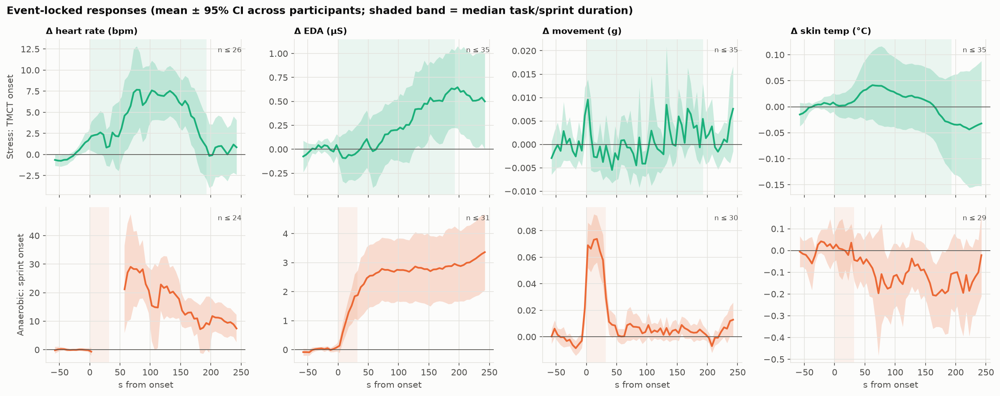

# Wearable Exercise Physiology Analytics

**Physiological responses to aerobic exercise, anaerobic sprints and acute psychological stress, measured with a wrist
wearable (Empatica E4).**

🌐 **Project page:** https://victorgomezadapty.github.io/wearable-exercise-physiology/ ·
📓 **Kaggle notebook:** https://www.kaggle.com/code/vctorandrsgmezlpez/wearable-physiology-stress-vs-exercise ·
📄 **Final report:** [docs/final_report.md](docs/final_report.md)

This project connects exercise physiology, wearable technology and data science. The principle: **understand the
signals first**, process each one appropriately, analyse people as the unit of inference, and only then ask what
machine learning can add, evaluated on people it has never seen.



## Main question

> How do wearable physiological signals differ between aerobic exercise, anaerobic exercise and acute stress, and
> how much of that difference is physiology rather than movement?

## Key findings

| | Acute stress (seated) | Aerobic cycling | Anaerobic sprints |
|---|---|---|---|
| Heart rate vs seated rest | **+5.0 bpm** (95% CI 2.2–7.8) | +19 moderate · **+49 bpm** peak | unmeasurable during sprint · +40 bpm after |
| EDA tonic level | ×1.6 | ×2.3 moderate · **×11** peak | ×3.4–4.5 |
| Wrist movement | **decreases** | rises with cadence | large bursts |

1. **Stress is a real but small autonomic response, with the wrist stiller than at rest.** It is not a movement
   artefact, and it is the same in both cohorts.
2. **Exercise dominates every channel**, about 10× the HR response. EDA stays flat, then rises steeply from ~95 rpm,
   consistent with a sweating threshold. Skin temperature does not rise.
3. **Signal quality decides everything.** Wrist-PPG heart rate is valid in ~60–67% of seated windows, 43% of aerobic
   stages and **3% of sprints**. Quality filtering (blind to expected outcomes) reveals the stress HR effect that raw
   Empatica HR hides.
4. **Physiology is individual** (ICC 0.83–0.99 for HR/EDA), so models must be validated on unseen participants.
   A leaky window split reports macro-F1 0.83; **leave-one-subject-out gives 0.66**.
5. **Combinations beat single signals** (0.66 vs 0.58 for movement alone). But in the three-class problem most of the
   gain is **movement plus a sensor-failure shortcut** (the PPG fails during sprints). Where movement can't help,
   **stress vs seated rest, physiology alone reaches 0.65**, with EDA the strongest single signal.

Not "AI detects stress and exercise with high accuracy", but an honest account of what a wrist wearable can and
cannot see.

## Data

[Wearable Device Dataset from Induced Stress and Structured Exercise Sessions](https://physionet.org/content/wearable-device-dataset/1.0.1/),
PhysioNet v1.0.1, DOI [10.13026/he0v-tf17](https://doi.org/10.13026/he0v-tf17), ODC-By. Hongn A., Bosch F., Prado
L. E., Ferrández J. M., Bonomini M. P., *Scientific Data* 12 (2025),
[10.1038/s41597-025-04845-9](https://doi.org/10.1038/s41597-025-04845-9). Stress n = 36, aerobic n = 30,
anaerobic n = 31; 30 participants completed all three.

## Notebooks

| # | Notebook | What it does |
|---|---|---|
| 01 | [Data understanding](notebooks/01_data_understanding.ipynb) | integrity, sampling rates, tags → protocol, 25-item issue registry |
| 02 | [Signal quality](notebooks/02_signal_quality.ipynb) | per-window quality rules (PPG SQI, HR agreement, cadence lock-in), HRV feasibility |
| 03 | [Protocol segmentation](notebooks/03_protocol_segmentation.ipynb) | cadence fidelity, reference periods, analysis states |
| 04 | [Exercise-physiology EDA](notebooks/04_exercise_physiology_eda.ipynb) | event-locked responses, stage profiles, individual responses, multimodal profile |
| 05 | [Feature engineering](notebooks/05_feature_engineering.ipynb) | 14 window features, univariate participant-level effects, redundancy |
| 06 | [Statistical analysis](notebooks/06_statistical_analysis.ipynb) | paired effects + bootstrap CIs, mixed models, ICC, self-report correlation, robustness |
| 07 | [Classification](notebooks/07_classification.ipynb) | LOSO validation, leakage demo, modality ablation, shortcut test, permutation importance |

Documentation: [data dictionary](docs/data_dictionary.md) · [protocol summary](docs/protocol_summary.md) ·
[methodology & decisions](docs/methodology.md) · [physiological interpretation](docs/physiological_interpretation.md) ·
[Phase 1 report](docs/phase1_report.md) · [final report](docs/final_report.md)

## Reproduce

```bash
pip install -r requirements.txt
```
```bash
python -m src.data.download
```
```bash
python -m src.pipeline
```
Then run notebooks `02` → `07` in order. Notebook `01` regenerates the Phase 1 inventory. `data/processed/` already
contains the derived tables, so notebooks 04–07 run without the raw data.

## Repository layout

```
data/        raw/ (PhysioNet, not committed) · interim/ (inventories, segments, issues) · processed/ (feature tables, results)
notebooks/   01–07
src/
  data/      empatica.py · inventory.py · protocol.py · issues.py · repairs.py · download.py
  signals/   processing.py (per-signal processing) · quality.py (window quality rules)
  features/  windows.py · profiles.py (event-locked responses)
  models/    stats.py (participant-level statistics) · classify.py (LOSO classification)
  visualization/plots.py
  pipeline.py
scripts/notebook_builders/   code that generates notebooks 02–07
site/        project web page (GitHub Pages)
docs/        reports and documentation
reports/figures/
```

## Limitations

Small, healthy, young sample. Cohort confounded with sex, training status, setting and protocol version. No ECG, power,
VO₂ or lactate reference. Wrist PPG is unreliable during cycling. The resting reference is on a different day from
exercise. Stress tasks are short. No clinical inference.

---
Code: MIT licence. Data and derived tables: ODC-By (see [LICENSE](LICENSE)). Author: Victor Gomez, physiotherapist
and personal trainer working in data science and human performance.
